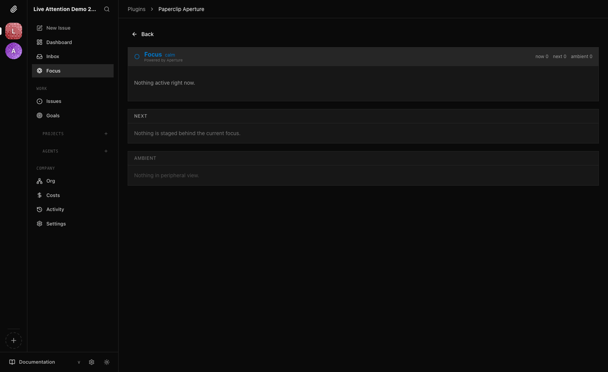

<div align="center">

# Paperclip Aperture

**The live attention layer for Paperclip, combining Aperture Core continuity with Paperclip-native operator policy.**

[](https://www.npmjs.com/package/@tomismeta/paperclip-aperture)
[](https://github.com/tomismeta/aperture)
[](https://www.npmjs.com/package/@tomismeta/aperture-core)
[](https://github.com/paperclipai/paperclip)


<p></p>
</div>

Paperclip Aperture adds a **Focus** surface to Paperclip, turning approvals, issue activity, and agent signals into three attention lanes:

- **now** — the single item that most needs your attention
- **next** — the queue behind it
- **ambient** — low-pressure awareness without an immediate demand for action

Inbox tells you what changed. Focus tells you what deserves attention now, with recommended moves and reasoning attached to the cards.

## Requirements

- **Node.js:** `>=24.11.0`
- **Paperclip:** official, unmodified `2026.1023.0` is the minimum API baseline and the tested stock host. Newer host versions are not automatically certified. See [known limitations](#known-limitations).
- **Aperture Core:** `0.10.0`, included as a dependency alongside `@paperclipai/plugin-sdk@2026.1023.0`

Version **0.6.0** upgrades the published `0.5.1` baseline from Core `0.9.0`, retaining the worker-owned integration and existing Focus behavior. No Paperclip fork or host patch is required.

## Install

Authenticate the CLI as an instance administrator for the intended Paperclip host, then check its target before installing. Set the URL below to that host:

```bash
export PAPERCLIP_API_BASE="http://127.0.0.1:3100"
npx paperclipai@2026.1023.0 plugin target --api-base "$PAPERCLIP_API_BASE"
npx paperclipai@2026.1023.0 plugin install @tomismeta/paperclip-aperture --version 0.6.0 --api-base "$PAPERCLIP_API_BASE"
```

The pinned CLI selects a client version; it does not upgrade or patch the server. If you need Paperclip first, follow its [host setup instructions](https://github.com/paperclipai/paperclip).

After installation, open Paperclip and select **Focus** in the sidebar. No plugin-specific API-base configuration or outbound HTTP access is required for approval handling; CLI `--api-base` selects the host and is separate from plugin configuration.

## What you get

- A Focus page, sidebar entry, and dashboard widget.
- Dynamic attention lanes with issue-aware recommendations, document/dependency context, and routing that distinguishes company agents from human operators.
- Native approval actions and inline plain confirmations with host-verified human attribution and fresh eligibility checks. Budget revisions, questions, and specialized requests hand off to native Paperclip pages.
- Separate cards for multiple decisions on the same issue; resolving one does not dismiss its siblings.
- Inline issue comments, with long summaries and failure diagnostics kept under **Show context** rather than crowding the headline.
- Durable acknowledgement and suppression backed by saved review state and ledger replay.
- Separate run-failure attention that preserves execution history and reflects authoritative retry/watchdog facts when the host supplies them.
- Diagnostics exports for the live Core state, the plugin-composed display, synchronization errors, and bounded Core traces.

## Understanding Focus

Reasoning stays attached to the cards you are acting on:

- **Why now** explains why the current item outranks the queue.
- **Why next** explains why an item is staged behind it.
- **Confidence** shows the strength of the semantic signal when available.
- **Signals** lists the factors that brought an item into attention.
- **Thread context** and **Related activity** show the surrounding episode.

Unread state is secondary to action pressure: an unread item is not automatically the most important item.

### Keeping your place

Opening **Show context** requests a 20-second focus hold; opening the comment composer requests 45 seconds. Holds preserve the current task or interaction against ordinary queue promotion while still showing fresh host content. Explicit urgency, Core preemption, terminal state, suppression, replacement, and ambient recovery can still take precedence.

Reads do not extend a hold. Expiry, worker restart, and session eviction end it. Comment drafts stay local to the mounted company/task/interaction and survive timestamp-only updates, but are not durable across displacement or company changes.

### Synchronization and persistence

Failed reconciliation keeps the last complete candidate set visible with a synchronization warning. Fresh summary/export reads require successful issue, agent, and interaction reconciliation; native approval overlays use a separate 15-second cache with event/action invalidation, including in exports.

Issue discovery uses the supported unpaged SDK collection; agent discovery remains paginated. Neither has a plugin-imposed total cap. Complete issue discovery depends on the host returning the complete accessible collection.

Company changes withhold the previous company's display while the new scope loads. Local review updates are serialized with persistence so concurrent tabs retain each other's acknowledgements.

Native comment writes and local state persistence are separate transactions. If Paperclip confirms a comment but local persistence fails, Focus reports that it posted with a synchronization warning rather than asking you to repost. Unknown native-write outcomes still report an error; this is not an exactly-once guarantee.

Subscription callbacks remain in memory until a scoped read or action hydrates and flushes state. A worker restart, the 30-minute idle eviction, or the 100-company session cap can discard unflushed callback facts. Saved history and review state are persisted separately from that pending buffer.

## Upgrading from 0.5.1

Back up host data and plugin configuration before upgrading, and meet the host and Node.js requirements above.

- Persisted attention state migrates from schema 3 to schema 5. Legacy approval acknowledgements remain local audit/suppression records; they do not become native approval decisions.
- Approval reads and decisions now use the native company-scoped SDK client. Stored `paperclipApiBase` values are ignored; the legacy worker HTTP adapter is removed.
- Approve/reject and issue comments require a host-authenticated human operator and retain that human's attribution.
- Do not purge plugin state or run an older worker against schema 5.

The native migration qualification used a no-force local-package switch and a cold host/worker restart. It does not certify the host's version-only upgrade endpoint or every historical state.

## Architecture

- **Aperture Core** owns continuity, replay, and attention mechanics through the existing stateful `ApertureCore` integration.
- **The plugin worker** owns ingestion, review state, reconciliation, display composition, and Paperclip-specific candidate/lane policy. The result is Core-backed, not Core-only.
- **Paperclip** owns native issue, interaction, and approval records, authorization, and the UI shell.

The worker resolves configuration per company. Configuration changes retain the host's worker-restart behavior. Diagnostics distinguish Core judgment, reconciliation, approval overlays, and final display promotion.

## Known limitations

These limitations apply to the stock host and remain part of this release:

- **Updates are not always instant.** Focus uses a 15-second visible-page polling cycle, plus visibility and action refresh. Reliable cross-client push is unavailable on the observed stock host; its stream endpoint returned HTTP 501.
- **Recovery visibility is incomplete.** The public worker API does not expose all retry/recovery facts. Complete recovery context and actual continuation are not certified. Missing facts do not mean no recovery is running.
- **Company navigation has a known host issue.** After switching companies and using browser Back, the host's company selector can disagree with the route. Tested plugin company-isolation guards remain intact; they do not fix the host selector.

The plugin retains its streaming hooks and conditional recovery/watchdog support when the host supplies the necessary facts. These are documented host limitations, not features removed for this release or a claim of full host-feature compatibility.

## Troubleshooting

- **Placeholder instead of Focus:** check the host's API baseline and the plugin's status, then refresh the UI. A matching version number alone does not establish full runtime compatibility.
- **Approval or comment permission errors:** use a host-authenticated human with access to the intended company. Adding a legacy API-base setting does not bypass native authorization.
- **Host version reported as `0.0.0`:** older Paperclip installers can misreport their version. Upgrade to a server release containing the host-version fix; do not lower the plugin's minimum version.
- **Windows `spawn npm ENOENT`:** the Paperclip installer cannot resolve npm. Ensure the host process can find `npm.cmd`, or use a Paperclip release with the installer fix. This plugin does not spawn npm during installation.

## Development

Use Node.js `>=24.11.0` and pnpm 10. CI uses Node.js `24.21.0`.

```bash
pnpm install
pnpm verify
```

`pnpm verify` runs typecheck, tests, the issue-intelligence corpus, a production build, and bundle-size checks. Before packaging a release, run:

```bash
pnpm release:check
```

Use disposable host instances for native testing, not your normal Paperclip data. For registry-install tests, isolate the host process's `HOME` as well as `PAPERCLIP_HOME`: this host stores downloaded plugins in `$HOME/.paperclip/plugins`, independently of `--data-dir`. Do not force-uninstall an existing user installation to prepare a test.

## Links

- [Paperclip Aperture on npm](https://www.npmjs.com/package/@tomismeta/paperclip-aperture)
- [Source repository](https://github.com/tomismeta/paperclip-aperture)
- [Contribution guide](https://github.com/tomismeta/paperclip-aperture/blob/main/CONTRIBUTING.md)
- [Aperture](https://github.com/tomismeta/aperture) · [Aperture Core on npm](https://www.npmjs.com/package/@tomismeta/aperture-core)
- [Paperclip](https://github.com/paperclipai/paperclip)
